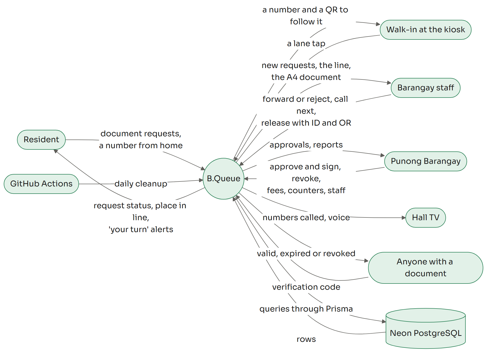
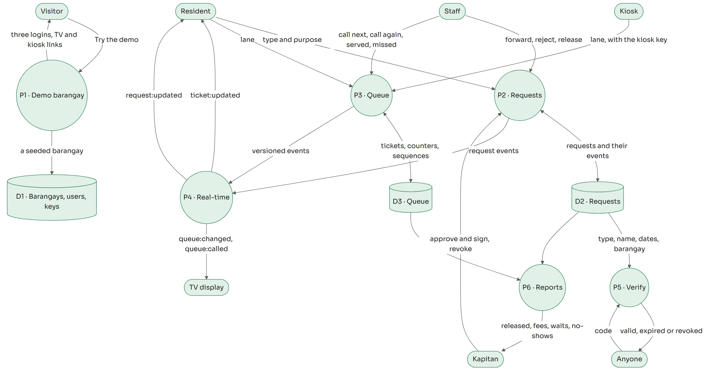
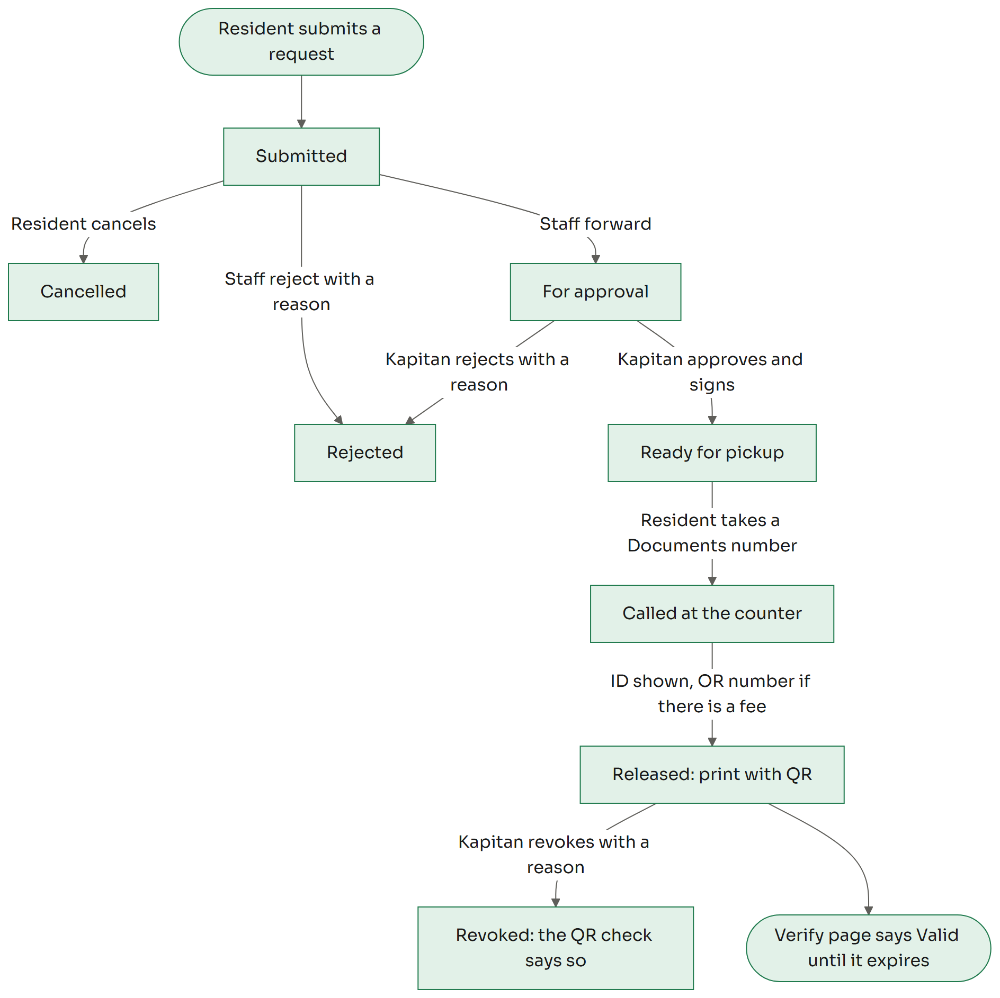
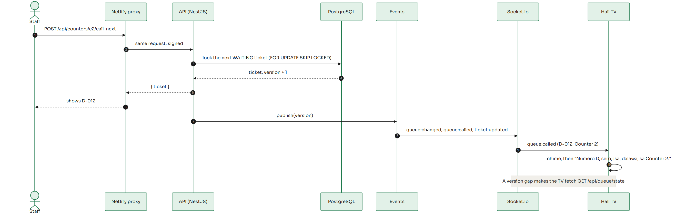

# B.Queue

Barangay requests and a live queue, in one place.

B.Queue lets residents request barangay documents (clearance, residency, indigency, business clearance, barangay ID)
from their phone and follow each step. Instead of waiting in a line at the hall, they take a number from home or from
the hall's kiosk, and the hall TV calls them. Staff forward requests, call numbers and release documents at a counter.
The Punong Barangay approves and signs, and sets fees, counters and staff. Every released document carries a QR code
that anyone can scan to check that it is real.

- **Live demo:** https://bqueue.netlify.app. Press "Try the demo" to get your own demo barangay for 24 hours, with a
  kapitan, staff, a resident, a TV link and a kiosk link. The free server can take up to a minute to wake up.
- **Languages:** English and Filipino, on every screen.

<!-- Screenshot added at go-live (Task 35). -->

## Architecture



| Part | Stack | Hosted on |
| --- | --- | --- |
| Web (`apps/web`) | Next.js 16, React 19, Tailwind 4, TanStack Query, next-intl, React Three Fiber | Netlify |
| API (`apps/api`) | NestJS 12, Prisma 7, Socket.io, Zod | Render (Docker, free plan) |
| Shared (`packages/shared`) | Zod schemas, view types, status rules, money and ticket helpers | used by both |
| Database | PostgreSQL 17 | Neon |

The browser only talks to the API through Netlify's proxy at `/api/*`. Netlify signs each request with
`PROXY_SIGNING_SECRET`, and the API refuses unsigned calls. The only exceptions go to Render directly: the health ping
that wakes the free instance, and the Socket.io connection, which Netlify cannot proxy.



### How a request moves



### How real-time works

- **Writes are REST.** Calling the next number, releasing a document and taking a ticket are all ordinary HTTP calls,
  so they work through the signed proxy and can be retried. A ticket is taken with an id the client makes, so a double
  tap or a retry after a lost answer gets the same number back.
- **Sockets only listen.** To connect, a page asks the API for a single-use socket ticket that lasts 60 seconds, then
  opens Socket.io with it. The ticket names the rooms the socket may join: the barangay's public queue, a resident's
  own tickets, staff and kapitan rooms, or one kiosk ticket's tracker.
- **Every queue change has a version.** The API sends `queue:changed` (a full snapshot), `queue:called` and
  `ticket:updated` after each change. A client that sees a version gap fetches `GET /api/queue/state`, and every
  reconnect starts with the current state, so a phone that slept or a TV that lost Wi-Fi catches up on its own.
- **Calling is safe with two counters.** "Call next" locks the next waiting ticket with `FOR UPDATE SKIP LOCKED`, so two
  counters never call the same number.



## Run it locally

Needs Node 24 and Docker.

```bash
npm ci
docker compose up -d
node tools/dev-proxy.mjs
BQ_DEV_PROXY=http://127.0.0.1:8788 npm run dev -w @bq/web
```

Then open http://localhost:3000 and press "Try the demo". `docker compose up -d` starts PostgreSQL and the API's
Docker image on port 8080. `tools/dev-proxy.mjs` signs requests the way Netlify does. The values in
`docker-compose.yml` are for this machine only.

## Tests

```bash
npm test
npm run test:api
npm run test:e2e
```

- `npm test` runs the unit and component tests for the web app and the shared package.
- `npm run test:api` runs the API tests against the local PostgreSQL on port 55434.
- `npm run test:e2e` runs Playwright against the production web build and the API's Docker image. Start the image
  first with `BQ_SITE_ORIGIN=http://localhost:3100 BQ_SIMULATOR=false docker compose up -d --build db api`.

The E2E specs cover a call reaching the TV and its voice, a resident's phone following its place in line, a request
from the resident to the kapitan's signature and a valid QR, the kiosk and its tracker, English and Filipino, the TV
reconnecting while the API restarts, and an axe accessibility check of the main screens. CI runs all of them on every
push.

## Deployment

- **API:** `render.yaml` describes the Render service. It deploys from `main` only after CI passes. Its secrets
  (`DATABASE_URL`, `DIRECT_URL`, `JWT_SECRET`, `SOCKET_TICKET_SECRET`, `PROXY_SIGNING_SECRET`, `CLEANUP_SECRET`,
  `IP_HASH_SALT`, `SITE_ORIGIN`) are entered in Render's dashboard, never in the repository. The container runs
  `prisma migrate deploy` before it starts.
- **Web:** `netlify.toml` builds the web app and proxies `/api/*` to Render with the signature. `PROXY_SIGNING_SECRET`
  is set in Netlify's environment.
- **Cleanup:** `.github/workflows/cleanup.yml` deletes expired demo barangays every day at 03:00 Manila time. GitHub
  pauses scheduled workflows after 60 days without activity, so the API also deletes expired barangays whenever a new
  demo is created.

## Credits

- UI adapted from "Donka Help Desk — Internal Request System" by Dayse (Figma Community), licensed under CC BY 4.0
  (https://creativecommons.org/licenses/by/4.0/). Changes: forest green accent, new brand, barangay screens and
  content, icons.
- 3D scene inspired by "Reeded liquid glass – Prism hero section concept" on Spline, rebuilt from primitives; no
  files from it are used.
- Fonts: Sora, Inter and Noto Serif, under the SIL Open Font License 1.1.
- Icons: Lucide, ISC License.

See [docs/credits.md](docs/credits.md) and the site's `/credits` page for the full list.
